

<a href="https://github.com/bil332204-code/internship-robots"></a>
<a href="https://github.com/bil332204-code/fixit-javafx-marketplace"></a>
<a href="https://github.com/bil332204-code/freelancing-marketplace-database"></a>

<a href="https://github.com/bil332204-code/internship-robots"></a>
<a href="https://github.com/bil332204-code/AiCON-2026-Milaan"></a>
<a href="https://github.com/bil332204-code/fixit-javafx-marketplace"></a>
<a href="https://github.com/bil332204-code/freelancing-marketplace-database"></a>
<a href="https://github.com/bil332204-code/fractal-cosmos"></a>


<a href="https://www.credly.com/badges/ce079680-69e7-4e2e-82f0-22fd3f1c6ae1/public_url"></a>

I prefer projects that solve a concrete problem and need different pieces to work together: humanoid robotics, computer vision, conversational AI, desktop app architecture, relational databases and hardware-oriented automation.

Also here: [DSA-LABS](https://github.com/bil332204-code/DSA-LABS) · [Information_Security_Labs](https://github.com/bil332204-code/Information_Security_Labs)

Cards are animated SVGs redrawn every morning from my contribution data by <a href="./scripts/render_readme_cards.py">a Python script</a> and a GitHub Action.
